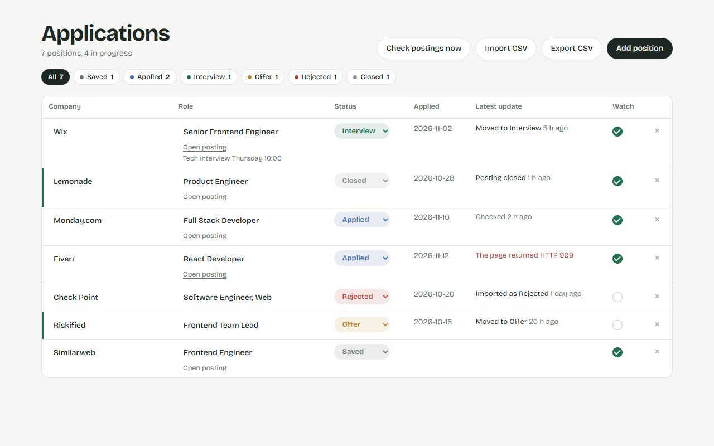
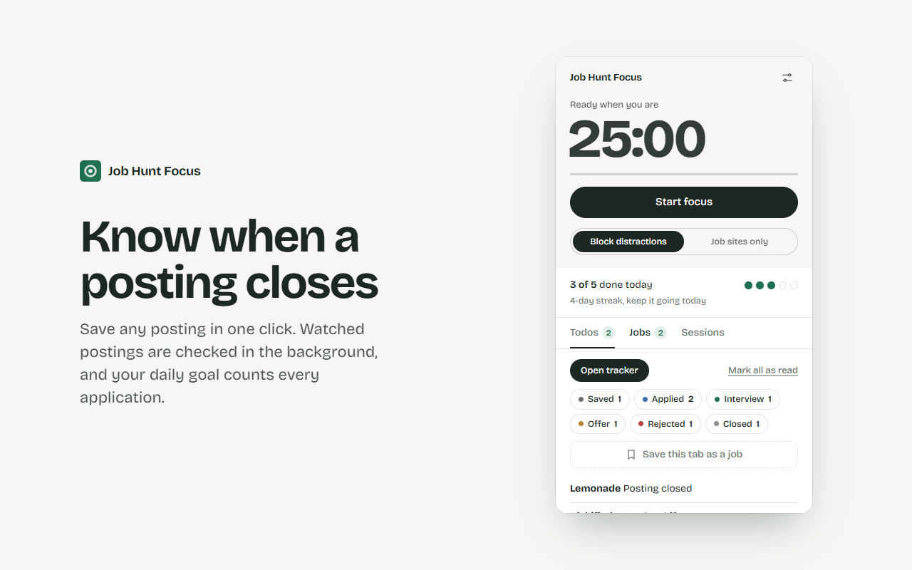

# Job Hunt Focus

A Chrome extension that keeps you focused while job hunting. It blocks distracting sites during Pomodoro sessions, tracks every application with CSV import and closed-posting detection, keeps a daily goal and streak, and saves tab sessions.


## Features

- **Focus sessions.** A Pomodoro timer with a countdown on the toolbar icon and a notification when each phase ends. Sites are blocked only while you're focusing.
- **Two blocking modes.** *Block distractions* blocks a list you choose. *Job sites only* blocks everything except LinkedIn, Indeed, Glassdoor, Gmail, Docs and any other site you add.
- **Application tracker.** A full-page table of every position, with the status pipeline Saved → Applied → Interview → Offer / Rejected / Closed.
  - **Save a job in one click.** Use the popup or the right-click menu on any posting. The tab title is parsed into a role and a company, which you can edit in the table.
  - **Import your existing spreadsheet.** Save it as CSV from Excel or Google Sheets. Columns are matched by name in English or Hebrew (e.g. Company, Job Title, Status, Link, Date). Free-text statuses like "Phone screen" or "נדחה" are recognized. Re-importing updates rows instead of duplicating them. See [docs/sample-positions.csv](docs/sample-positions.csv).
  - **Notes, reflections and linked todos.** Expand any row to:
    - write notes
    - add todos linked to that position. A role's skills prompt suggestions, so a "Python Developer" posting suggests *Learn Python*.
    - write a reflection when a position is rejected, answering "what would I do better next time?". Moving a row to Rejected opens this box for you.
  - **Lessons from rejections.** Every reflection is collected below the table, so you can spot patterns across rejections.
  - **Linked todos in the popup** show which position they belong to and open it in the tracker.
  - **Export to CSV** for backup. Exports are Excel-safe and keep Hebrew text intact.
  - **Closed-posting detection.** Postings you watch are re-checked in the background (every 3 hours by default). A posting that's taken down is marked Closed and you get a notification.
- **Todo list** for everything else on your plate.
- **Daily goal and streak.** Finished to-dos and positions moved to Applied count toward a daily target, and the streak grows on every day you hit it.
- **Tab sessions.** Save a window of tabs under a name and reopen it later.
- **A focus page instead of a dead end.** A blocked site shows how much time is left, your progress and your next to-dos.
- **Private.** All data stays in `chrome.storage.local`. There are no accounts, and the only network requests are the posting checks you turn on. See [PRIVACY.md](PRIVACY.md).



| | |
|---|---|
|  |  |
|  |  |

## Tech

- Manifest V3 with a module service worker
- `declarativeNetRequest` dynamic rules for blocking
- `chrome.alarms`, `chrome.storage`, `contextMenus` and `notifications`
- TypeScript compiled by plain `tsc`, with no bundler and no framework
- A dependency-free CSV parser and exporter, and regex-based posting checks that run in the MV3 service worker
- Unit tests with `node:test`, plus end-to-end tests with Puppeteer. The end-to-end tests load the real extension into Chrome for Testing and use a local fake internet to cover:
  - blocking and allowlist redirects
  - CSV import and posting checks
  - the security guards: no requests to local-network addresses, hostile pages can't stall the worker, the blocked page can't be framed
- CI runs both on GitHub Actions and builds a store-ready `.zip`.

Posting checks read the page's HTML without running its JavaScript. Pages that load their content with JavaScript, or block automated requests (LinkedIn often does), show an error in the tracker instead of a wrong status.

## Develop

```sh
npm install
npm run build        # or: npm run watch
npm test             # builds, then runs the unit tests
npm run e2e:setup    # once: downloads Chrome for Testing into .cache/
npm run test:e2e     # loads the real extension in Chrome and tests it end to end (offline)
npm run preview      # UI preview with sample data at http://127.0.0.1:5179/popup.html (?focus, ?break, ?empty)
```

To load the extension:
1. Open `chrome://extensions` and turn on **Developer mode**.
2. Click **Load unpacked** and pick the `extension/` folder.
3. After a rebuild, click the reload icon on the extension card.

To regenerate the store screenshots, keep `npm run preview` running and run `node tools/screenshots.mjs`. It uses headless Chrome.

## Publishing

The store package is the `extension/` folder, zipped. Every CI run builds it as an artifact, or build it locally:

```powershell
npm run build
Compress-Archive -Path extension\* -DestinationPath job-hunt-focus.zip -Force
```

Store screenshots and the promo tile are in `store/screenshots/`. Regenerate them with `npm run preview` plus `node tools/screenshots.mjs`. The privacy policy is [PRIVACY.md](PRIVACY.md).

## License

[MIT](LICENSE)
