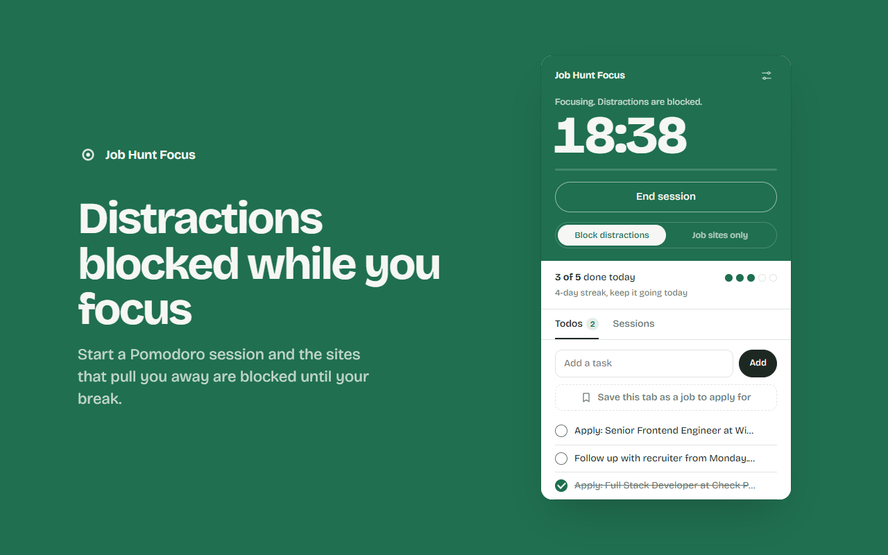
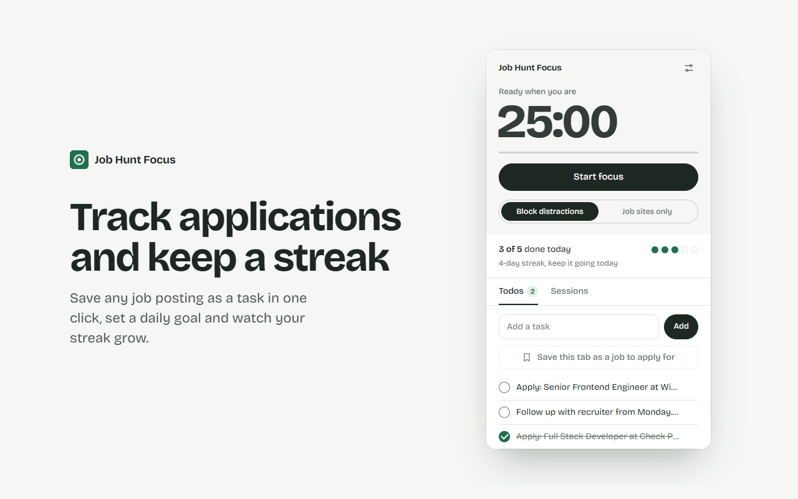
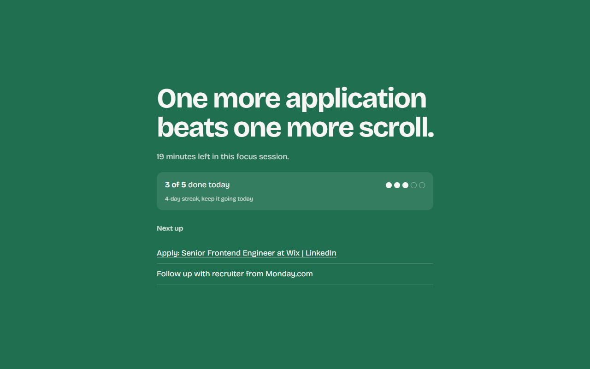
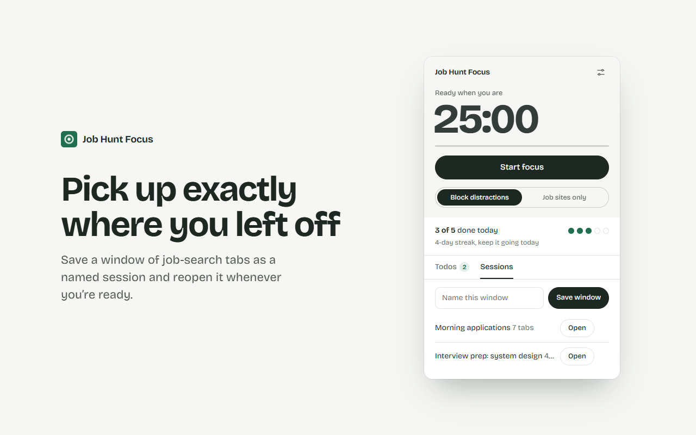

# Job Hunt Focus

A Chrome extension that keeps you focused while job hunting. It blocks distracting sites during Pomodoro sessions, turns job postings into a to-do list, tracks a daily goal and streak, and saves tab sessions.


## Features

- **Focus sessions.** A Pomodoro timer with a countdown on the toolbar icon and a notification when each phase ends. Sites are blocked only while you're focusing.
- **Two blocking modes.** *Block distractions* blocks a list you choose. *Job sites only* blocks everything except LinkedIn, Indeed, Glassdoor, Gmail, Docs and any other site you add.
- **Save a job in one click.** Use the popup or the right-click menu, and the posting becomes `Apply: <title>` with a link back.
- **Daily goal and streak.** Completed to-dos count toward a daily target, and the streak grows on every day you hit it.
- **Tab sessions.** Save a window of tabs under a name and reopen it later.
- **A focus page instead of a dead end.** A blocked site shows how much time is left, your progress and your next to-dos.
- **Private.** All data stays in `chrome.storage.local`. There are no accounts and no network requests. See [PRIVACY.md](PRIVACY.md).

| | |
|---|---|
|  |  |
|  |  |

## Tech

- Manifest V3 with a module service worker
- `declarativeNetRequest` dynamic rules for blocking
- `chrome.alarms`, `chrome.storage`, `contextMenus` and `notifications`
- TypeScript compiled by plain `tsc`, with no bundler and no framework
- Unit tests with `node:test`, run in CI on GitHub Actions. Each CI run also builds a store-ready `.zip`.

## Develop

```sh
npm install
npm run build        # or: npm run watch
npm test             # builds, then runs the unit tests
npm run preview      # UI preview with sample data at http://127.0.0.1:5179/popup.html (?focus, ?break, ?empty)
```

To load the extension:
1. Open `chrome://extensions` and turn on **Developer mode**.
2. Click **Load unpacked** and pick the `extension/` folder.
3. After a rebuild, click the reload icon on the extension card.

To regenerate the store screenshots, keep `npm run preview` running and run `node tools/screenshots.mjs`. It uses headless Chrome.

## Publishing

The store listing text, permission justifications and upload steps are in [store/listing.md](store/listing.md).
